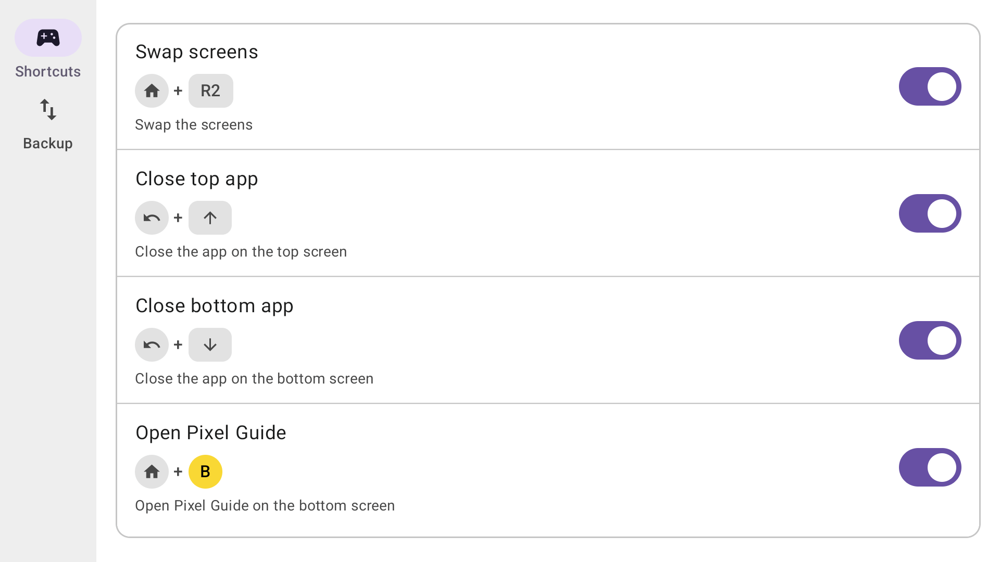

# Thorcuts

Button shortcuts for the AYN Thor. Bind a combo to:

1. Swap the two screens
1. Move the app in front to the other screen
1. Close the app on a screen
1. Close all apps on a screen
1. Go home on a screen
1. Open an app on a screen
1. Take a screenshot of a screen
1. Change a screen's brightness



## What it needs

- An AYN Thor on its stock firmware. Tested on the firmware dated 2026-02-06 (Android 13, build
  `TKQ1.231222.001/eng.Thor.20260206.163241`).
- The Thor's "Force SELinux" setting must stay off. It is off out of the box; AYN's own "Run
  Script as Root" needs it off too.

No rooting, no Shizuku, no computer needed.

## Install

Download the APK from the [latest release](https://github.com/grardb/Thorcuts/releases/latest)
on the Thor and open it. Android asks once to allow installs from the browser. From a computer
instead:

```
adb install -r thorcuts.apk
```

An update installs over the old version and keeps your shortcuts.

On the first open, turn on the switch at the top of the Shortcuts screen. Android asks to allow
notifications; [The notification](#the-notification) says why.

## The first shortcut

1. Turn the switch on. Add is disabled while it is off.
2. Tap **Add shortcut** and give it a name.
3. Tap **Record**, press the combo, let go. While recording, nothing you press reaches the
   device.
4. Choose **Tap** or **Timer**. Tap fires the moment the combo is complete. Timer fires once the
   combo has been held for the milliseconds you set (400 by default).
5. Choose the action and, where it applies, the screen: the top screen, the bottom screen,
   whichever screen has focus (the one the Thor's Focus Mode locks to, or the last touched on
   Auto-lock), or — for brightness and for closing all apps — both. A brightness action also
   takes a percent.
6. Choose where it applies: **Everywhere**, **Everywhere except…** some apps, or **Only in…**
   some apps. The last two need the accessibility service; see
   [Per-app shortcuts](#per-app-shortcuts).
7. Tap **Save**.

A shortcut must start with AYN, Home, Back, Start or Select. A shortcut on Start or Select
makes a plain tap of that button reach the game only when it is released, and a hold only after
half a second.

The **Backup** tab exports your shortcuts to a JSON file and imports one back. Import adds
shortcuts; it never replaces one you already have.

## The notification

Android requires a notification while shortcuts are on. To hide it, long-press it and turn it
off.

To bring it back, go to Settings → Apps → Thorcuts → Notifications and turn "Running in the
background" on again. The row then reappears after the switch goes off and on again, or after
a reboot.

## Per-app shortcuts

A shortcut that applies only in some apps, or everywhere except some, needs to know which app
is in front on each screen. Android lets an app know that through an accessibility service, so
Thorcuts has one. It reports which app is in front on each screen and reads nothing else: no
text, no input, no content.

Thorcuts asks for it only once a shortcut needs it: a notice appears on the Shortcuts screen
with a **Turn on** button that opens Android's accessibility settings. Turning Thorcuts on
there is the whole setup.

## Important: If the controller stops responding

**Hold Home + Select for 4 seconds.** Thorcuts lets go of every input device and stops; the
controller is yours again. This works whatever else is going on, and no shortcut can override
it.

Force-stopping Thorcuts also works (Settings → Apps → Thorcuts → Force stop): the controller is
released within 3 seconds, and shortcuts stay off until you open Thorcuts again.

## How it works, honestly

The Thor ships a root daemon: the one behind Settings → Thor → "Run Script as Root". Thorcuts
starts its input helper through it, as root. Your Thor is never rooted, but Thorcuts does run
as root, through a door AYN left open. If you turn "Force SELinux" on, that door closes and
Thorcuts stops working.

The helper takes exclusive control of the controller and re-emits a virtual one, named and
numbered like the real one, so games keep working and a bound combo never leaks into them.
Screen actions use the same privileged route; there is no other. A screenshot of the bottom
screen is the same frame grab Android's own tools use, run the same way. A brightness shortcut
sets a screen's level the way its slider does, through Android's own per-screen brightness.

Thorcuts declares four Android permissions and nothing else: running a foreground service, its
special-use type, starting at boot, and posting the notification above. The accessibility
service is separate, and you enable it yourself. Your shortcuts live in the app's private
storage, and nothing leaves the device unless you export it.

## Known limitations

- If you ever re-assigned the controller inside an emulator because the Thor showed two of
  them, do it once more after installing Thorcuts: the controller's identity changes.
- A shortcut on Start or Select delays that button for the game: a plain tap arrives when it
  is released, a hold after half a second. A timer-style combo on one of them reaches the game
  only after the timer or the release, so it feels late there.
- A force-stop leaves shortcuts off until the next time you open Thorcuts.
- A notification you turned back on reappears only after the switch goes off and on again, or
  after a reboot.
- A screenshot of the bottom screen goes straight to the gallery, with a toast on the top
  screen. Only the top screen gets Android's own screenshot popup.
- "Swap the screens" is a one-way move when one screen shows only the launcher: the app crosses
  over, and the launcher fills the screen it left. Closing an app shows the launcher; a screen
  is never left blank.
- Closing all apps on a screen leaves a picture-in-picture window where it is.

## Building from source

The native helper is cross-compiled with NDK `30.0.16248370` (or point `ANDROID_NDK` at yours;
the script assumes a macOS NDK, so set `HOST` on Linux):

```
native/build.sh
./gradlew :app:assembleDebug
```

`native/build.sh` writes the helper to `app/src/main/jniLibs/arm64-v8a/`; the app does not
work without it. Tests: `native/test/run.sh` for the helper, `./gradlew test` for the Kotlin
modules.

A release build is signed when a `keystore.properties` exists at the repo root;
`keystore.properties.example` lists the keys. A release build will not install over a debug
build (different keys): uninstall first.

## License

MIT — see [LICENSE](LICENSE). © 2026 Gerard O'Neill.
